# Farmacia · Sistema de escritorio

Aplicación de escritorio (Python + Tkinter) para llevar el **inventario, las entradas, las ventas y los reportes** de una farmacia o botica pequeña. Los datos se guardan en archivos JSON locales: no necesita internet ni base de datos.

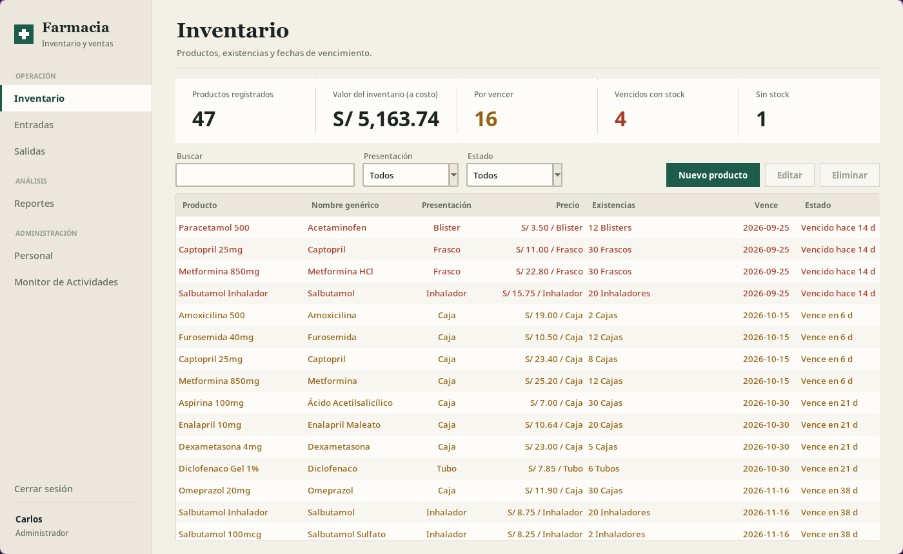

## Características

- **Inventario** con indicadores (productos, valor a costo, por vencer, vencidos, sin stock), búsqueda, filtros por presentación y estado, y alerta de vencimiento por colores.
- **Unidades como en una farmacia real:** un producto se compra por caja y se vende por caja, blister o tableta suelta. Las existencias se muestran como *«7 Cajas + 1 Blister (180)»*.
- **Precio por unidad:** cada nivel (caja, blister, tableta) tiene su propio precio de venta, con sugerencia automática (prorrateo + recargo) y margen visible. Líquidos, inhaladores y geles se venden solo por empaque completo.
- **Costo promedio** por unidad base, recalculado en cada compra; los reportes guardan una «foto» de cada movimiento y no cambian si luego editas precios.
- **Entradas** de productos existentes o nuevos, con precio de compra por caja.
- **Salidas** con total en vivo según la unidad elegida.
- **Reportes** por rango de fechas (inversión, ventas, utilidad) con exportación a **PDF**.
- **Usuarios y roles** (administrador / personal), con monitor de actividades del personal. El personal de mostrador no ve costos ni valor del inventario.

## Capturas

### Acceso
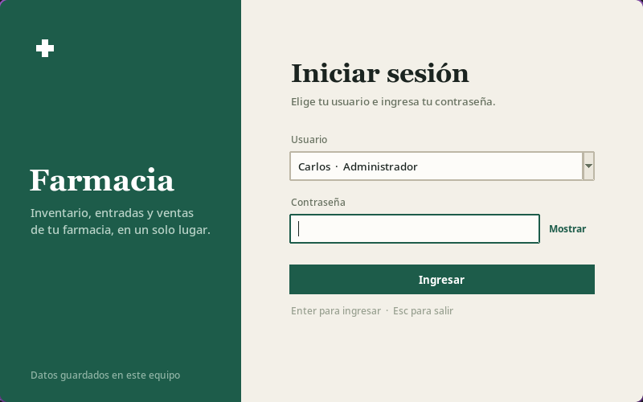

### Administrador

| Inventario | Editar producto |
|---|---|
|  | 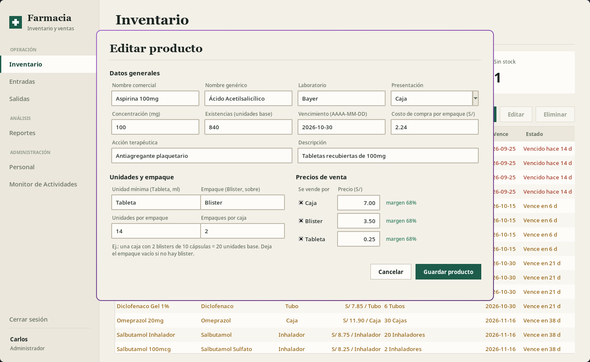 |

| Entradas · producto existente | Entradas · producto nuevo |
|---|---|
| 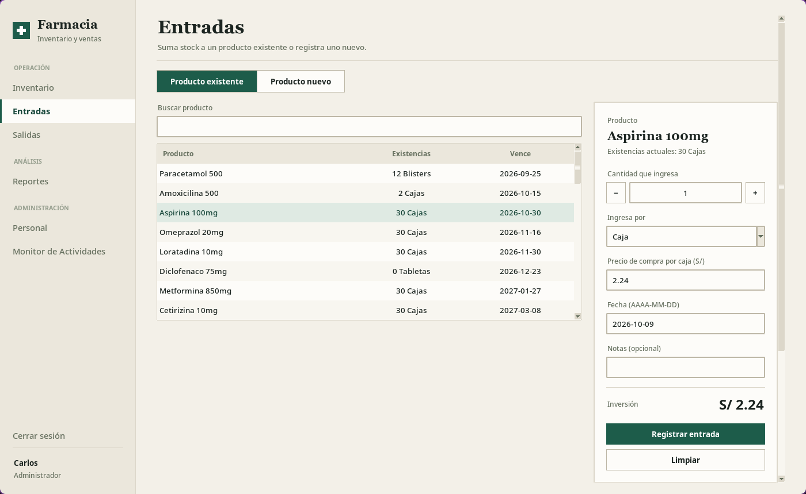 | 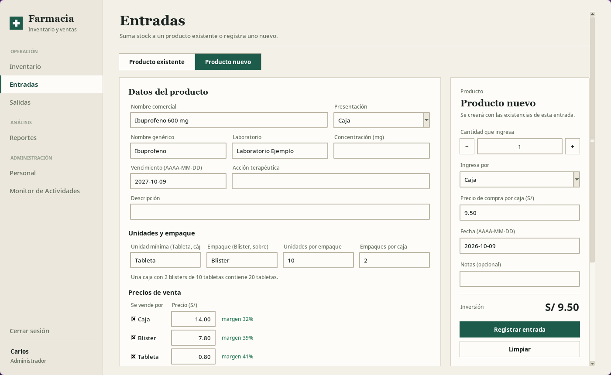 |

| Salidas | Reportes |
|---|---|
| 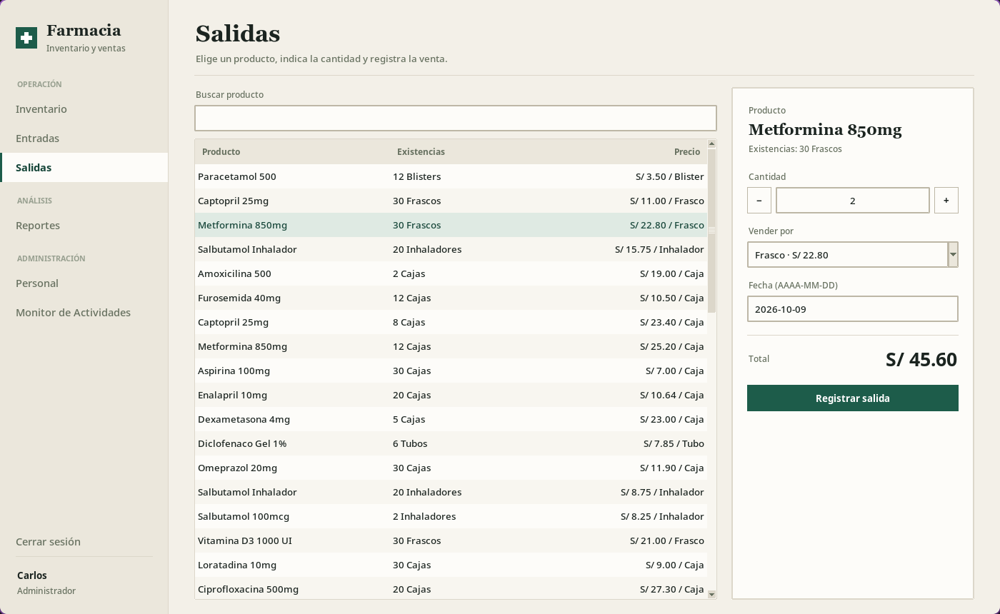 | 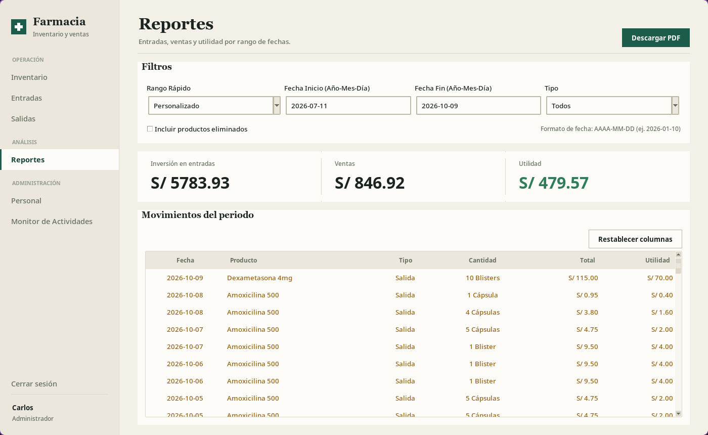 |

| Personal | Monitor de actividades |
|---|---|
| 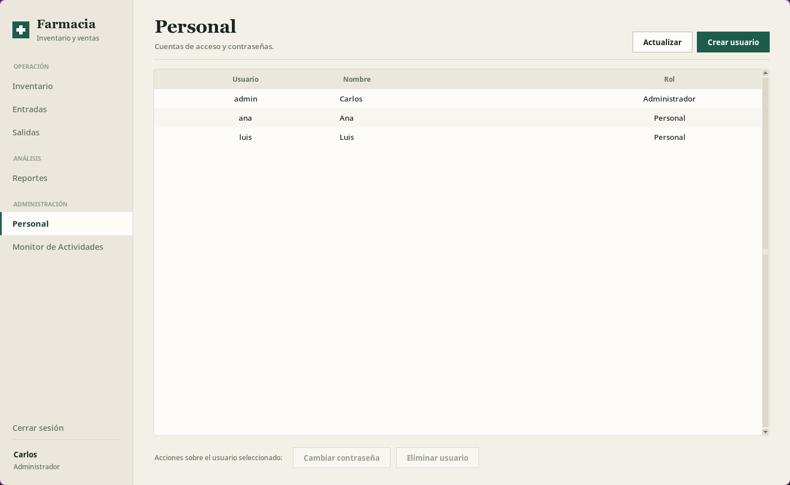 | 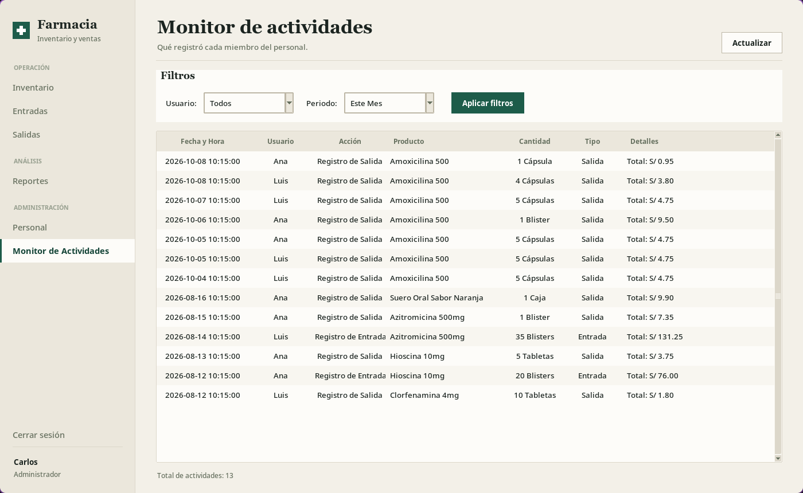 |

### Personal de mostrador
Solo ve las secciones operativas y no puede modificar productos ni ver costos.

| Inventario | Salidas |
|---|---|
| 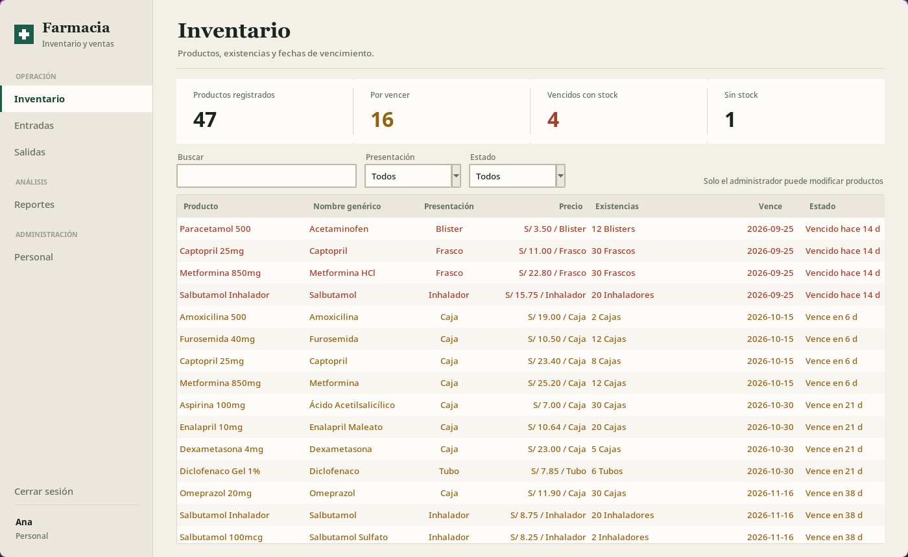 | 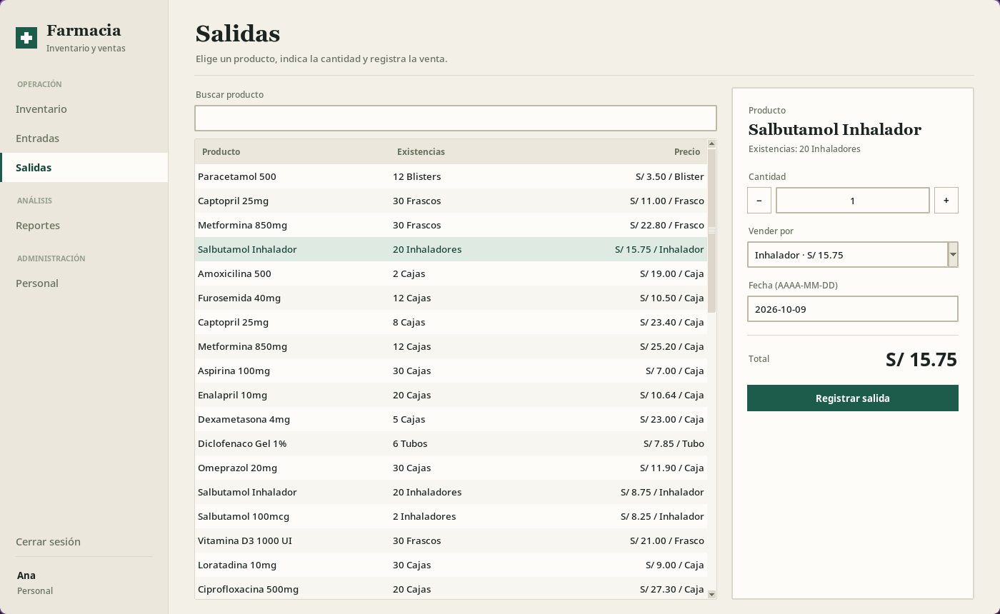 |

> Las capturas usan los datos de ejemplo de `demo_data/` (productos y personas ficticias).

## Requisitos

- Python 3.10 o superior con Tkinter (en Linux: `sudo pacman -S tk` / `sudo apt install python3-tk`).
- Dependencia opcional para exportar PDF: `reportlab`.

```bash
python -m venv .venv
source .venv/bin/activate        # Windows: .venv\Scripts\activate
pip install -r requirements.txt
python farmacia.py
```

## Primer uso

Al iniciar por primera vez la app pregunta **dónde guardar los datos** y crea las cuentas mínimas:

| Usuario | Contraseña inicial | Rol |
|---|---|---|
| `admin` | `admin` | Administrador |

**Cambia esa contraseña de inmediato** desde *Personal → Cambiar contraseña* y crea las cuentas del personal con *Crear usuario*.

### Probar con datos de ejemplo

La carpeta [`demo_data/`](demo_data) trae 47 productos, movimientos y personal ficticio. En la pregunta inicial elige **«No»** (carpeta existente) y selecciona `demo_data`. Cuentas de ejemplo:

| Usuario | Contraseña | Rol |
|---|---|---|
| `admin` | `admin` | Administrador |
| `ana` | `demo` | Personal |
| `luis` | `demo` | Personal |

> Trabaja sobre una copia de `demo_data/` si no quieres modificar los ejemplos. Los vencimientos del ejemplo están calculados respecto al día en que se generó.

## Cómo se modelan las unidades y los precios

El stock se guarda siempre en **unidades base** (tableta, cápsula, ml…). Cada producto define su jerarquía, por ejemplo: *Caja = 2 blisters × 10 cápsulas = 20 cápsulas*. Sobre ella:

- `prices`: precio de venta de **una** unidad de cada nivel (caja, blister, unidad).
- `sellable_units`: niveles en que se puede vender.
- `avg_cost_base`: costo promedio ponderado por unidad base.
- Cada movimiento guarda `base_quantity`, `unit_price`, `line_total` y `line_cost`, de modo que los reportes no dependen de precios posteriores.

Los datos anteriores con un solo precio sin unidad se migran automáticamente la primera vez (se crean copias `*_pre_pricing_backup.json`).

## Estructura del proyecto

```
farmacia.py            punto de entrada
adell/
  domain.py            unidades, precios, costos y formato de cantidades
  store.py             persistencia JSON, usuarios, migración
  app.py               ventana principal, menú y arranque
  ui/                  tema visual y componentes reutilizables
  views/               una pantalla por archivo
demo_data/             datos de ejemplo (ficticios)
docs/screenshots/      capturas de este README
```

## Generar el ejecutable

```bash
pip install pyinstaller
pyinstaller AdellFarma.spec
```

## Seguridad y datos

- Los datos reales (`data/`, `path_config.json`) **no se versionan**: están en `.gitignore`.
- Las contraseñas se guardan con SHA-256 sin sal, adecuado para uso local en un solo equipo pero no para exponer los archivos. No publiques tu carpeta de datos.
- Haz copias de seguridad periódicas de la carpeta de datos que elegiste.
